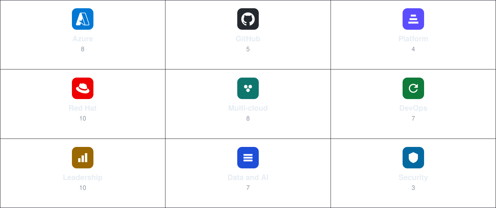
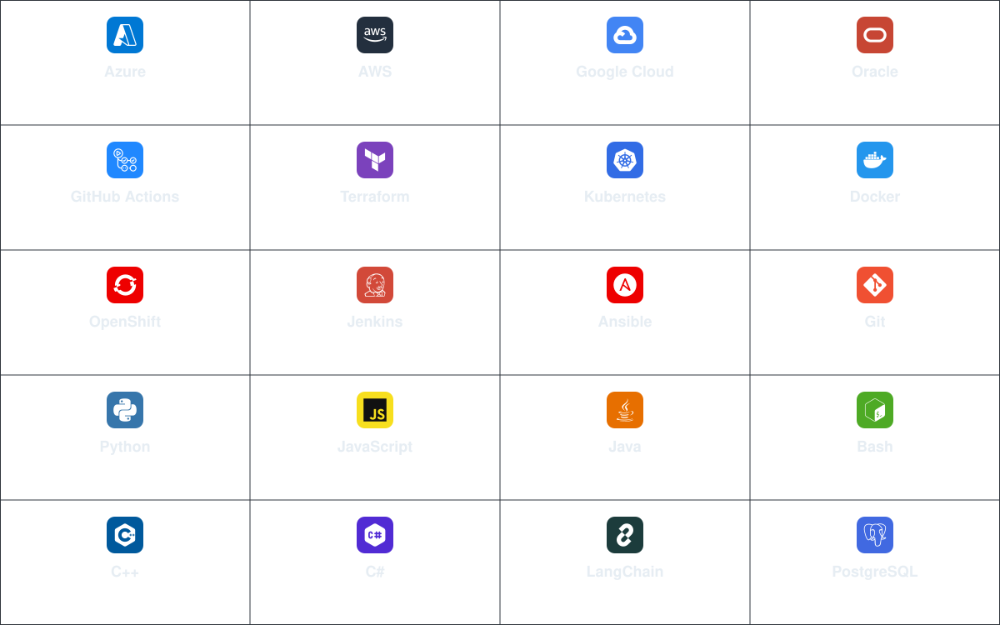

# Oscar Lobaton Salas

**Platform Engineer · DevOps · SRE · FDE**

Systems engineer leading platform strategy, DevSecOps, and generative AI at Peru's largest financial group. InnerSource across 15 companies and 8,000+ developers. Delivery speed +22%. Documentation search time −75%. DevOps Institute Ambassador.

B.Sc. Systems Engineering, UNI · GPA 4.0 · AI Engineering, Hanyang Cyber University, in progress.

## Activity

Public activity on this account.

  <picture>
    <source media="(prefers-color-scheme: dark)" srcset="https://github-readme-stats.vercel.app/api?username=0vas&show_icons=true&hide_border=true&theme=github_dark" />
    
  </picture>
  <picture>
    <source media="(prefers-color-scheme: dark)" srcset="https://streak-stats.demolab.com?user=0vas&theme=github-dark&hide_border=true" />
    
  </picture>

## Speaking

11 talks across Latin America, Europe, the United States, and Asia. Decks at [slides.0vas.com](https://slides.0vas.com).

<table width="100%">
<tr>
<td width="33%" valign="top">
  
<b>Abstracción en Platform Engineering</b> 
<a href="https://www.f13.pe/">F13 Code Summit</a> · Lima
  
<b>Jueves de Quack: InnerSource con Credicorp</b> 
<a href="https://www.youtube.com/watch?v=aWz3BWj3d00">GitHub LATAM</a> · YouTube
  
<b>Números Bonitos, Madurez Falsa</b> 
DevOpsDays Medellín
  
<b>Construyendo un Framework de Platform Engineering</b> 
DevOpsDays Buenos Aires
</td>
<td width="33%" valign="top">
  
<b>Building Bridges: Scaling InnerSource</b> 
<a href="https://innersourcecommons.org/">InnerSource Summit</a> · Germany, USA, Japan
  
<b>Más allá de DevOps: InnerSource como catalizador de la agilidad</b> 
Agile Summit · Lima
  
<b>La Evolución del Open Source en la Cultura Empresarial</b> 
<a href="https://devopsdays.org/events/2025-santiago/welcome/">DevOpsDays Santiago</a>
  
<b>Las Mentiras de las Métricas</b> 
<a href="https://devopsdays.org/events/2025-lima/welcome/">DevOpsDays Lima</a>
</td>
<td width="33%" valign="top">
  
<b>Gestionando el conocimiento con Documentation as Code</b> 
DevSecOps Fest · Lima
  
<b>Adopción de GenAI para revolucionar el desarrollo de software</b> 
DevOpsDays Medellín
  
<b>Impulsando la productividad del desarrollador con GitHub Copilot</b> 
GitHub · YouTube
</td>
</tr>
</table>

## Certifications

62 credentials across nine groups. The board links to [Credly](https://www.credly.com/users/oscar-andres-lobaton-salas/badges). The same registry is on [0vas.com](https://0vas.com).

<a href="https://www.credly.com/users/oscar-andres-lobaton-salas/badges">
  <picture>
    <source media="(prefers-color-scheme: light)" srcset="assets/certs/board-light.svg" />
    
  </picture>
</a>

<b>All 62 certifications</b>

<table width="100%">
<tr>
<td valign="top" width="33%"> <b>Azure · 8</b> 
<b>Solutions Architect Expert</b> 
<b>DevOps Engineer Expert</b> 
<b>AI Engineer Associate</b> 
Developer Associate 
Administrator Associate 
Fundamentals 
Data Fundamentals 
AI Fundamentals  
 <b>GitHub · 5</b> 
Foundations 
Actions 
Administration 
<b>Advanced Security</b> 
<b>Copilot</b>  
 <b>Platform · 4</b> 
<b>Certified Practitioner</b> 
Introduction 
Observability 
AI in Platform Engineering</td>
<td valign="top" width="33%"> <b>Red Hat · 10</b> 
OpenShift AI Workshop 
Cloud Automation 
Windows Automation with Ansible 
OpenShift on AWS 
Ansible for RHEL 
Containers and Cloud-Native 
Ansible for Security 
Azure Red Hat OpenShift 
Event-Driven Architecture 
Getting Started with OpenShift  
 <b>Multi-cloud · 8</b> 
Google Cloud Computing Certificate 
Google Cloud Computing Foundations 
Google Cloud Core Infrastructure 
Google Cloud Core Services 
Google Cloud Digital Leader 
AWS Technical Essentials 
OCI Foundations Associate 
IBM Cloud Essentials  
 <b>DevOps · 7</b> 
<b>Terraform Associate</b> 
GitOps Fundamentals 
DevOps Practices and Tools 
DevSecOps Habits 
Docker Essentials 
Kubernetes Essentials 
Git</td>
<td valign="top" width="33%"> <b>Leadership · 10</b> 
<b>McKinsey Forward</b> 
<b>Harvard Aspire</b> 
Harvard Negotiation 
PMI GenAI Overview 
PMI GenAI Data Landscape 
PMI Management 
Scrum Foundation 
Digital Marketing 
IBM Design Thinking 
Jira Fundamentals  
 <b>Data and AI · 7</b> 
IBM AI Fundamentals 
Reactive Architecture 
RDBMS Essentials 
Oracle DB Foundations 
Oracle DB Next Level 
Oracle DB Performance 
Samsung IoT  
 <b>Security · 3</b> 
<b>CyberOps Associate</b> 
CCNA Introduction to Networks 
Cyber Security Foundation</td>
</tr>
</table>

## Stack

<picture>
  <source media="(prefers-color-scheme: light)" srcset="assets/stack/board-light.svg" />
  
</picture>

## Open source

- [hyperion](https://github.com/0vas/hyperion) — human-guided workflows for AI tools
- [quadrant-dev-prompt-engineering](https://github.com/0vas/quadrant-dev-prompt-engineering) — prompt engineering framework
- [migrator-azdevops-wiki-to-github](https://github.com/0vas/migrator-azdevops-wiki-to-github) — Azure DevOps wiki to GitHub Wiki
- [enterprise-repository-bridge](https://github.com/0vas/enterprise-repository-bridge) — copy repos across private organizations
- [slides-builder](https://github.com/0vas/slides-builder) — decks as code, published at [slides.0vas.com](https://slides.0vas.com)

Portfolio: [0vas.com](https://0vas.com)
